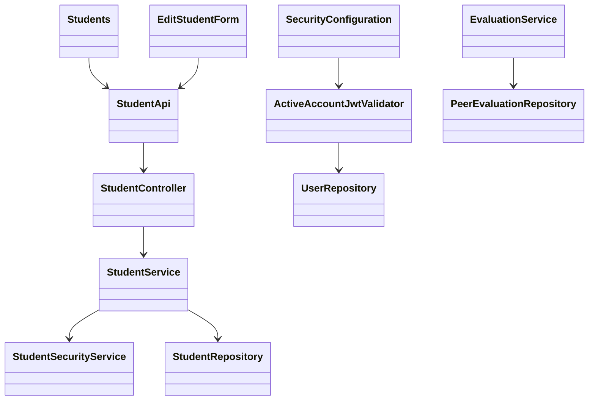

# Student Design

> Realizes: [UC-STU-deactivate-student](../requirements/use-cases.md#uc-stu-deactivate-student-the-course-admininstructor-deactivates-a-student)
> Depends on FRs: [FR-SEC-active-account](../requirements/software-requirements-specification.md#non-use-case-functional-requirements)
> Rules: BR-student-lifecycle, BR-student-deactivation-team, BR-deactivated-evaluatee, BR-submission-owed, BR-section-scoped-access, BR-role-based-access.
> Architecture: [Container view](architectural-design.md#containers), [Crosscutting Concepts](architectural-design.md#crosscutting-concepts); shared entities are defined by the SRS [Business Domain Model](../requirements/software-requirements-specification.md#business-domain-model).

## Overview

Extend the existing student vertical slice and its Vue client. A dedicated command changes the existing account flag; shared authentication and peer-evaluation paths enforce its consequences. This design covers deactivation only. Existing reactivation behavior is not expanded into a new endpoint or workflow.

## Components & classes



- Reused/extended: [Students.vue](../../frontend/src/pages/students/Students.vue), [EditStudentForm.vue](../../frontend/src/pages/students/EditStudentForm.vue), [student API](../../frontend/src/apis/student/index.ts). The student detail/edit view offers the dedicated action after loading the student's details (UC steps 2–3).
- Reused/extended for compatibility: [UserInfo.vue](../../frontend/src/pages/currentUser/UserInfo.vue), the other student profile-update caller, also supplies its originally loaded `expectedEnabled` snapshot.
- Reused/extended: [StudentController](../../backend/src/main/java/team/projectpulse/student/StudentController.java), [StudentService](../../backend/src/main/java/team/projectpulse/student/StudentService.java), [StudentSecurityService](../../backend/src/main/java/team/projectpulse/student/StudentSecurityService.java), [StudentRepository](../../backend/src/main/java/team/projectpulse/student/StudentRepository.java).
- New: `security/ActiveAccountJwtValidator.java`, a Spring Security `OAuth2TokenValidator<Jwt>` backed by the reused [UserRepository](../../backend/src/main/java/team/projectpulse/user/UserRepository.java).
- Reused/extended: [SecurityConfiguration](../../backend/src/main/java/team/projectpulse/security/SecurityConfiguration.java), [EvaluationService](../../backend/src/main/java/team/projectpulse/evaluation/EvaluationService.java), [PeerEvaluationRepository](../../backend/src/main/java/team/projectpulse/evaluation/PeerEvaluationRepository.java), and [SubmitTeamsEvaluations.vue](../../frontend/src/pages/evaluations/SubmitTeamsEvaluations.vue).
- Reused unchanged unless regression evidence requires a fix: [SubmissionStatusService](../../backend/src/main/java/team/projectpulse/notification/SubmissionStatusService.java), existing reminder callers, DTO converters, `Result`, and exception advice.

## Sequence

```mermaid
sequenceDiagram
    actor Instructor as Course admin or instructor
    participant UI as Student detail/edit view
    participant Security as JWT decoder and route rule
    participant Service as StudentService
    participant Access as StudentSecurityService
    participant DB as Repositories
    Instructor->>UI: Identify and view student (steps 1–2)
    Instructor->>UI: Choose Deactivate (step 3)
    UI-->>Instructor: Consequences and confirmation (step 4)
    alt Cancel or dismiss (4a)
        UI-->>Instructor: Close warning; no request
    else Confirm (step 5)
        UI->>Security: POST /students/{studentId}/deactivate
        Security->>DB: Verify caller still exists and is enabled
        Security->>Service: Authenticated instructor/admin request
        Service->>Access: Derive caller role and instructor identity
        Service->>DB: Load student by ID and caller scope in transaction
        alt Unauthorized (6b)
            Service-->>UI: 403; no changes
        else Already inactive (6a)
            Service-->>UI: 200; already deactivated
        else Active
            Service->>DB: Save enabled=false; preserve relationships/work
            Service-->>UI: 200; saved student (step 6)
            UI-->>Instructor: Success and refreshed status (step 7)
        end
    end
```

The server checks permission before the already-inactive result. An unauthorized caller cannot use repetition to obtain a successful response. Missing students and failed persistence follow extensions 2b/6c and 6d respectively.

## API contract

All paths use `/api/v1`; responses use the existing `Result` envelope and DTO conventions.

| Endpoint | Caller | Request | Success | Errors and extension |
|---|---|---|---|---|
| `POST /students/{studentId}/deactivate` (new) | Active instructor assigned to the student's course section, or active course admin owning its course | Path ID; no body | `200`, updated `StudentDto`; message distinguishes `Student deactivated successfully` from `Student is already deactivated`; inactive account returned for both | Unauthenticated/disabled caller: `401`; wrong role or unrelated instructor/admin: `403` (2a/6b); missing student: `404` (2b/6c); invalid path ID: `400`; persistence failure: existing `5xx` envelope, no success (6d) |
| `PUT /students/{studentId}` (changed) | Existing profile-edit callers | Existing DTO plus required boolean query parameter `expectedEnabled`, taken from the original GET and not the editable switch | Existing profile update response; intentional inactive-to-active edits remain available through the existing control | Missing/invalid `expectedEnabled`: `400`; a mismatch with the current stored status: `409`, no changes, reload required. Reject active-to-inactive requests with `400` and direct the caller to Deactivate. Validate before changing any profile fields |
| `POST /evaluations` (changed, creation only) | Existing authorized evaluator | Existing request creating a new evaluation | Existing response for active evaluatee | Existing evaluation validation response (`400`) for an inactive evaluatee, per BR-deactivated-evaluatee; no saved row. Existing update endpoint and open-window rules still govern retained evaluations |
| Existing course-section weekly peer-evaluation report | Existing authorized report reader | Existing course-section ID/week | Existing report shape, with inactive evaluatees selected per BR-deactivated-evaluatee | Existing permission and validation errors unchanged |
| All JWT-protected requests (changed) | Existing callers | Existing JWT | Existing response when current account is active | `401` for a missing or disabled current account, including a previously issued, otherwise-valid JWT |

In `SecurityConfiguration`, place the explicit POST deactivation matcher before the deny-all fallback and require either `ROLE_admin` or `ROLE_instructor`. `StudentService.deactivateStudent` derives the caller's instructor identity through `StudentSecurityService`, then uses a caller-scoped `StudentRepository` finder inside the transaction: the query requires both the student ID and either course-admin ownership or an assigned instructor with that identity. Never load a student entity unscoped and compare ownership afterward. If the scoped query is empty, an existence-only check distinguishes an unknown ID (`404`) from an existing out-of-scope target (`403`); it must not return or load the out-of-scope entity. An admin role alone never grants access to another course. Extend the shared student read authorization helper to recognize an owning course admin so step 2 is reachable even when that admin is not separately assigned to the course section; preserve self-read behavior.

## Key decisions

- **Preserve membership:** apply BR-student-deactivation-team. Rejected automatic removal because current membership is needed by existing reports and reactivation must not silently reconstruct team history.
- **Live account validation:** compose the new validator with Spring's existing/default JWT validators; retain signature and time checks. Resolve the issued `userId` claim to a current user, verify the subject still matches, and fail closed for missing/disabled users or invalid identity claims. Rejected waiting for the two-hour token expiry because FR-SEC-active-account applies to protected access. No enabled-state cache is introduced.
- **Scoped service authorization:** require caller scope in the repository query, using current course/course-section links before mutation. Rejected an unscoped entity load followed by an ownership comparison, which contradicts the architecture's two-enforcement-point convention. Also rejected a role-only decision and reuse of the self-edit authorization manager: a student may edit her own profile but cannot deactivate herself, and an instructor role conveys no cross-course authority.
- **Dedicated mutation:** the active-to-inactive generic edit is rejected, rather than silently applying or ignoring it. For an active student the edit form shows a read-only status and a separate Deactivate action; the existing control for an already inactive student's reactivation remains available. Rejected leaving generic active-to-inactive edits enabled because they bypass the warning and command contract. Do not add a reactivation endpoint or confirmation workflow in this change.
- **Stale-edit protection:** capture `expectedEnabled` when loading the edit form; never overwrite that snapshot when the instructor changes the existing status switch. Send it with the existing PUT. Compare it to stored status before any mutation, under a row lock shared by profile update and dedicated deactivation. Both paths acquire `PESSIMISTIC_WRITE` inside their service transactions through caller-scoped finders; a check followed by an unlocked save is insufficient. The profile-update finder admits student self as well as the existing instructor/admin scope; only the existing instructor/admin status-edit capability may reactivate. A mismatch returns `409` and the UI reloads before offering another save. A deliberately loaded inactive account (`expectedEnabled=false`) can still be reactivated using the existing control. Update both `EditStudentForm.vue` and `UserInfo.vue` callers to supply the snapshot. Rejected removing that control because reactivation is outside scope; rejected a client-only refresh because deactivation can race the save. This changes concurrency safety, not the reactivation use case's flow.
- **Repetition:** no save when already inactive, with an explicit result message. Rejected a conflict error because a repeated confirmed request should safely converge on the intended state.
- **Historical inclusion:** an inactive student appears for a requested week only when `findByWeekAndEvaluateeId` finds retained evaluations, including if she has subsequently lost her team assignment. Active students retain the existing on-team report inclusion behavior. Rejected filtering the entire report by enabled status because it erases historical results. Existing score/comment calculations and privacy rules are reused.
- **Evaluation entry:** filter inactive targets in the student evaluation UI and recheck on the server at submission. Rejected a client-only filter because open pages and direct requests can be stale. Retained evaluation edits follow the existing window rules; this feature adds no editing policy.
- **Failure feedback:** disable duplicate submission while the command runs. A network timeout means the result is unknown: refresh the student before retry, then display the refreshed state. Rejected unconditional retry or a success toast before the response, which can misrepresent persistence. A failed transaction rolls back its changes.

## Data model

No new table, column, migration, timestamp, or membership snapshot. Use `PeerEvaluationUser.enabled`, the existing course/course-section/team links, and retained evaluations. Report inclusion is based on the existence of evaluations for the requested week, not an inferred deactivation date.

## Reuse & cross-cutting

Reuse the existing Spring resource server, exception advice, role conventions, JPA transactions, Vue/Element Plus components, shared Axios client, and reminder definition. Authentication validation and shared authorization/evaluation changes are trunk work and get separate commits before controller/UI leaves. The developer reads those commits before remaining implementation proceeds.

The existing architecture already assigns account/authentication to the foundation and evaluations/reminders to performance tracking. This adds behavior within those owners; there is no container, deployment, or RAM ownership delta. Its Authentication paragraph currently records the as-built two-hour-token gap; the live validator designed here closes that gap. Updating that platform-level paragraph requires separate confirmation and has not been done in this design branch.

## Tests

Each row is an implementation obligation; coverage is recorded by actual test name and executed result in the build PR. Unit tests cannot substitute for the real-JWT or persistence rows.

| Row | Use case, flow / oracle | Level | Asserts |
|---|---|---|---|
| STU-01 | Steps 2–7, warning Associated Information | Cypress integration | Loaded student details; warning names all consequences; cancel/confirm labels; one confirmed POST; success and refreshed inactive status |
| STU-02 | 4a | Cypress integration | Cancel button, dismiss/Escape send zero POSTs; account remains active |
| STU-03 | Step 6, BR-student-lifecycle | Unit + backend integration | Assigned instructor and owning course admin each succeed; admin need not be separately assigned to the course section; active-to-inactive flag persisted |
| STU-04 | 2a/6b, BR-section-scoped-access | Unit + backend integration | Unrelated instructor, another course's admin, and student self receive `403`; no student/profile/team/work changes, even when target is already inactive |
| STU-05 | Existing-login Associated Information, FR-SEC-active-account | Unit + real-JWT backend integration | Obtain a real JWT while active, deactivate via authorized caller, reuse old JWT on a protected route and receive `401`; new login denied; active-account access remains valid; missing user/invalid identity also refused |
| STU-06 | 6a | Unit + backend integration | Initially inactive target and repetition after success produce `200` with already-inactive message; unit verifies no additional save |
| STU-07 | 2b/6c | Unit + backend integration | Missing ID returns `404` to authenticated instructor/admin without mutation; malformed ID `400`; no credentials `401` |
| STU-08 | 6d | Unit + backend integration | Failed save does not produce success; transaction does not persist flag change or touch prior work |
| STU-09 | 6d | Cypress integration | Failed/timeout request shows failure or unknown-result feedback, no premature success; status is refreshed before retry; duplicate clicks do not send concurrent commands |
| STU-10 | BR-student-deactivation-team, BR-student-lifecycle | Backend integration | On-team and no-team students can be deactivated; team link and actual stored WAR/evaluation records survive with values unchanged |
| STU-11 | BR-submission-owed | Unit + backend integration | Inactive student receives neither scheduled nor on-demand reminder; active teammate who evaluated every active teammate owes no evaluation of the inactive student |
| STU-12 | BR-deactivated-evaluatee | Unit + backend integration | Creation targeting inactive evaluatee rejected with no saved evaluation; same-team active evaluatee still accepted in an open window; permitted edits of retained evaluations still succeed inside the existing window and fail after it closes |
| STU-13 | BR-deactivated-evaluatee | Unit + backend integration | Inactive student with received evaluations included for that week with original scores/comments, including no-team history; absent in a week with none; active on-team student retains existing behavior |
| STU-14 | Step 4, dedicated-action Associated Information | Unit + backend integration | Crafted generic PUT requesting active-to-inactive fails `400` before any profile mutation; normal profile update of an active student leaves her active. This row makes no new guarantee about the existing reactivation path |
| STU-15 | BR-deactivated-evaluatee | Cypress integration | Inactive team members not offered as new evaluation targets; retained evaluations remain reachable for permitted edits; stale-page server rejection shown without a success message |
| STU-16 | Stale-edit Associated Information; reactivation scope constraint | Unit + backend integration + Cypress integration | Load an active profile, deactivate it separately, then save the old form: `409`, no profile changes, account remains inactive, UI reloads without success. Verify `expectedEnabled` stays the loaded snapshot when the switch changes; a missing/invalid snapshot fails `400`; a deliberately loaded inactive account retains the existing authorized reactivation behavior. A concurrent profile-save/deactivation test verifies row-lock serialization, rather than an unlocked read/check/save |

## Open questions / risks

- Docker-dependent backend integration tests and a running app are required for verification. Tests not executed are reported as not verified; no success is inferred from a test's presence.
- A request already authorized before deactivation commits may finish. The contract denies the next request after commit; no cancellation of an in-flight request is introduced.
- An account-status database lookup is added per JWT authentication. Database failures fail closed; testing must distinguish this from successful authentication.
- This design uses current team/course links, as the existing model does. It introduces no historical membership reconstruction or deactivation-date reporting.
- The existing reactivation flow remains outside this implementation. STU-16 is a regression check on its compatibility with the approved stale-edit precondition; it does not implement a new reactivation use case.
